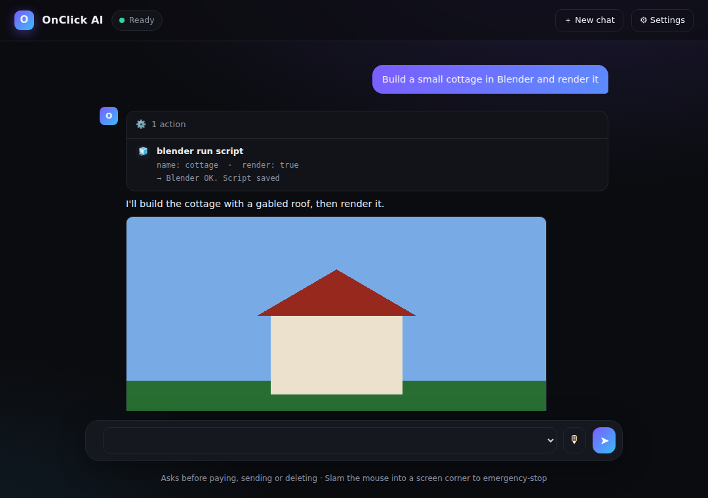

# OnClick AI

Type what you want. OnClick AI does it on your PC.

> "Find the cheapest Bengaluru → Delhi flight next Friday and take me to checkout"
> "Build a modern two-storey house in Blender and render it at sunset"
> "Write a Python script that sorts my Downloads folder by file type, then run it"

OnClick AI is a Windows desktop app (`OnClickAI.exe`). You give it a prompt, and an AI model plans the task and carries it out with real tools: a visible web browser, your terminal, your files, Blender, and mouse-and-keyboard control of any app. It looks at the result of every step (page text, screenshots, renders) and keeps going until the job is done.



## Download

Grab the newest `OnClickAI.exe` from **[Releases](../../releases)**. Every push to `main` builds a fresh one on GitHub Actions.

First launch opens **Settings**: pick a provider and paste an API key.

| Provider | Default model | Key |
|---|---|---|
| Gemini (default, has a free tier) | gemini-3.8-flash | aistudio.google.com/apikey |
| OpenAI | gpt-4.1 | platform.openai.com |
| Anthropic | claude-sonnet-4-5 | console.anthropic.com |
| OpenRouter | any | openrouter.ai |
| Groq | llama-3.3-70b (no vision) | console.groq.com |
| Ollama | runs locally, no key | ollama.com |

Pick a model with vision (Gemini, GPT-4.1, Claude) for screen control and checking Blender renders.

## What it can do

| Tool group | Tools | Used for |
|---|---|---|
| Browser | open, snapshot, click, type, select, press, scroll, back, screenshot | Flights, hotels, shopping, forms, any website. Uses your installed Edge with its own saved profile, so a site you sign into once stays signed in. |
| Web | web_search, fetch_url | Fast lookups without opening a browser |
| System | run_command (PowerShell), open_app, read/write/list files, ask_user | Installing software (winget, pip), scripts, coding projects |
| Blender | blender_run_script, blender_open | Writes bpy scripts, builds the scene, renders a PNG, looks at the render, and fixes it |
| Windows look | windows_settings: dark/light mode, transparency, taskbar alignment and auto-hide, wallpaper, accent color, one-call macOS-style setup (dock, translucent taskbar, Quick Look, PowerToys, Seelen UI) | "Make my PC dark mode and look like a Mac" |
| Desktop | screenshot, mouse_click, mouse_drag, type_text, press_keys, scroll, wait | Any app without a better route |

**Voice:** press the mic, speak in Kannada, Hindi, Hinglish, Tamil, Telugu or English. Speech is transcribed by Gnani Prisma and short replies are read back with Gnani Timbre (needs a Gnani API key in Settings).

Everything it makes is saved in `C:\Users\<you>\OnClickAI\`.

## Safety

- It **always asks you first** before clicking anything that pays, books, orders, sends, or publishes, and before commands that delete or change system data.
- It never types card numbers. You finish payment yourself in the open browser.
- It asks you for details only you know (dates, names, which option) instead of guessing.
- **Emergency stop:** slam the mouse into any screen corner, or press Stop.

## Run from source

```bash
pip install -r requirements.txt
python -m onclick            # window
python -m onclick --cli      # terminal chat
python -m onclick "make a hello world website in my workspace and open it"
```

## Build the exe yourself

```bash
pip install -r requirements-dev.txt
pyinstaller --onefile --windowed --name OnClickAI --collect-all playwright run.py
```

## How it works

```
prompt → model plans → tool call → real action (browser / shell / Blender / mouse)
       → observation (text, screenshot, render) → model checks it → next step … → done
```

- `onclick/agent.py` the loop, approvals, image handling
- `onclick/llm.py` provider clients (OpenAI-style and Anthropic) with tool calling
- `onclick/tools/` browser, web, system, desktop, Blender
- `onclick/safety.py` what needs your OK
- Long tasks stay cheap: only the newest browser page snapshot and the last few tool outputs are kept whole; older ones are trimmed to a few hundred characters, so a 30-page browsing task stays around 35k characters of context instead of 240k.
- Gemini 3 thought signatures are passed back untouched on every tool call, which multi-step tool use on Gemini 3 requires.
- `onclick/ui/index.html` + `onclick/webapp.py` the chat window (Edge WebView2); `onclick/gui.py` classic fallback window; `onclick/__main__.py` CLI

## Honest limitations (today)

- Not yet proven end to end against a real model in CI; tests use a scripted fake model. A real-model eval is next on the list.
- Desktop apps are driven by screenshots and coordinate clicks, which is slow and can miss. Windows UI Automation control is planned.
- No saved chat history, plan checklist or markdown rendering in the window yet.
- The exe is unsigned, so Windows SmartScreen warns on first run (More info, then Run anyway).

## Roadmap

- Global hotkey and tray icon
- Task history and resumable runs
- Accessibility-tree control of Windows apps (faster and more reliable than clicking pixels)
- Blender add-on mode (drive the open Blender window live)
- Parallel sub-agents for research-heavy tasks
